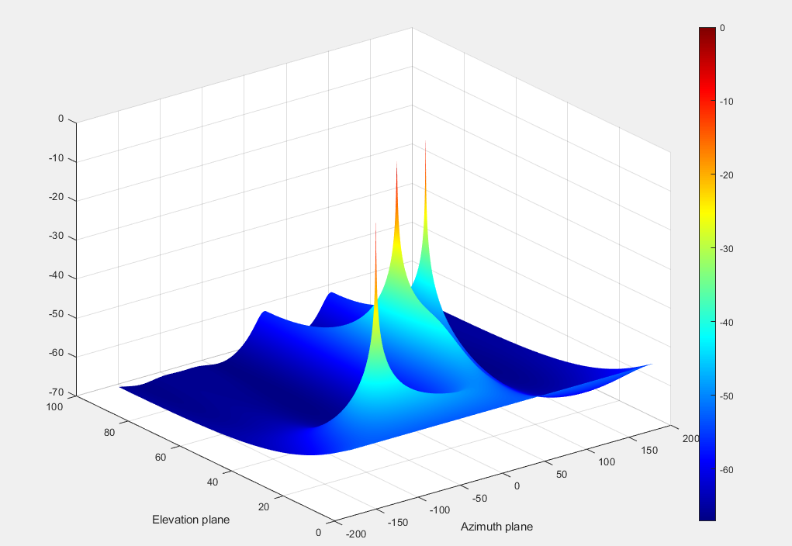
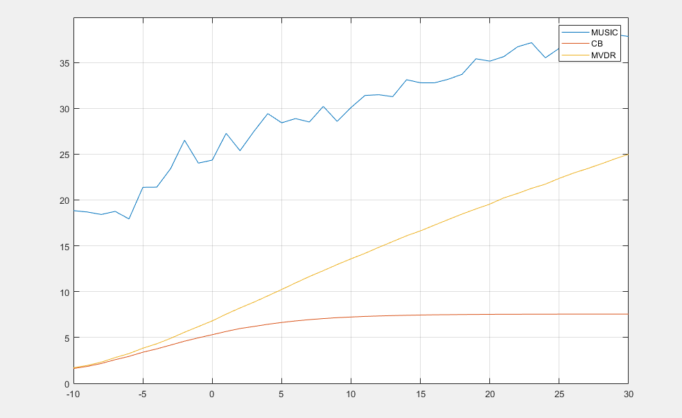
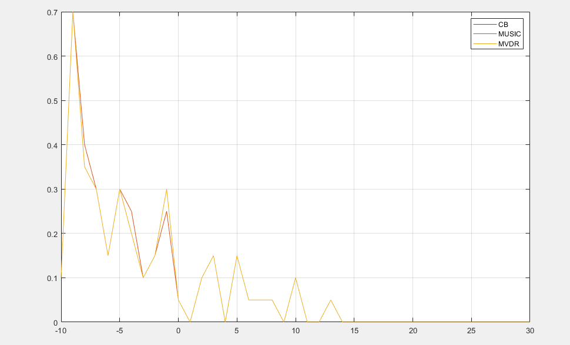

# DOA Estimation Based on Uniform Circle Array - MUSIC Direction of Arrival Algorithm [with MATLAB Code]

And compare the DOA estimation error through MUSIC, CB, MVDR three methods.
close all\nclear\nclc\n​\n%% (1) Initializing signal model, UCA configuration and simulation parameters\nFs = 48000; Ts = 1/Fs; % Sampling frequency (Hz), Sampling period (s)\nts = Ts:Ts:0.1; % Sampling time (s)\nf1 = 1325; s_A = 1*sin(2*pi*f1*ts).'; % Signal A's frequency (Hz), Signal A's amplitude (mV)\nf2 = 1350; s_B = 1*sin(2*pi*f2*ts).'; % Signal B's frequency (Hz), Signal B's amplitude (mV)\nf3 = 1375; s_C = 1*sin(2*pi*f3*ts).'; % Signal C's frequency (Hz), Signal C's amplitude (mV)\nSn = length(ts); % Snapshots\nSNR = 30; % Signal to noise ratio (SNR)\nangles_A = [-120 10]*pi/180; % Signal A's DOA [azimuth elevation]\nangles_B = [0 40]*pi/180; % Signal B's DOA [azimuth elevation]\nangles_C = [70 50]*pi/180; % Signal C's DOA [azimuth elevation]\nc = 343; % Sound propagation's speed in the air\nlambda_max = c/min([f1 f2 f3]); % Lambda max\nNe = 6; % Number of elements\nD = 3; % Number of signals\nR = 0.5*Ne*lambda_max/(2*pi); % Array's radius\nk = 2*pi/lambda_max; %  Array's angular coefficient\nk1 = 2*pi/(c/f1); %  Signal A's angular coefficient\nk2 = 2*pi/(c/f2); %  Signal B's angular coefficient\nk3 = 2*pi/(c/f3); %  Signal C's angular coefficient\nphi = -180:0.05:180; % Azimuth plane\ntheta = 0:0.05:90; % Elevation plane\nfor l = 1:Ne\n    a_A(l) = exp(1j*k1*R*sin(angles_A(2))*cos(angles_A(1)-2*pi*((l-1)/Ne))); %Signal A's steering vector at array\n    a_B(l) = exp(1j*k2*R*sin(angles_B(2))*cos(angles_B(1)-2*pi*((l-1)/Ne))); %Signal B's steering vector at array\n    a_C(l) = exp(1j*k3*R*sin(angles_C(2))*cos(angles_C(1)-2*pi*((l-1)/Ne))); %Signal C's steering vector at array\nend\nfor l = 1:Ne\n    x_A(l,:) = a_A(l)*s_A; % x0_A=a0_A*s0_A \n    x_B(l,:) = a_B(l)*s_B; % x0_B=a0_B*s0_B \n    x_C(l,:) = a_C(l)*s_C; % x0_C=a0_C*s0_C\nend\nx = x_A+x_B+x_C; %x0=∑x0i (i=1,2,...,Ne); Tổng tín hiệu tại mảng\nx = awgn(x,SNR,'measured'); % Compute Gaussian distribution in MATLAB simulation results

## Images

<!-- PAYMENT_BLOCK -->

## Get this dataset

- Payment link (Stripe): [Buy now](https://buy.stripe.com/3cs8yP7sY87d0vu9AB)
- Payment QR code: 

<!-- /PAYMENT_BLOCK -->
